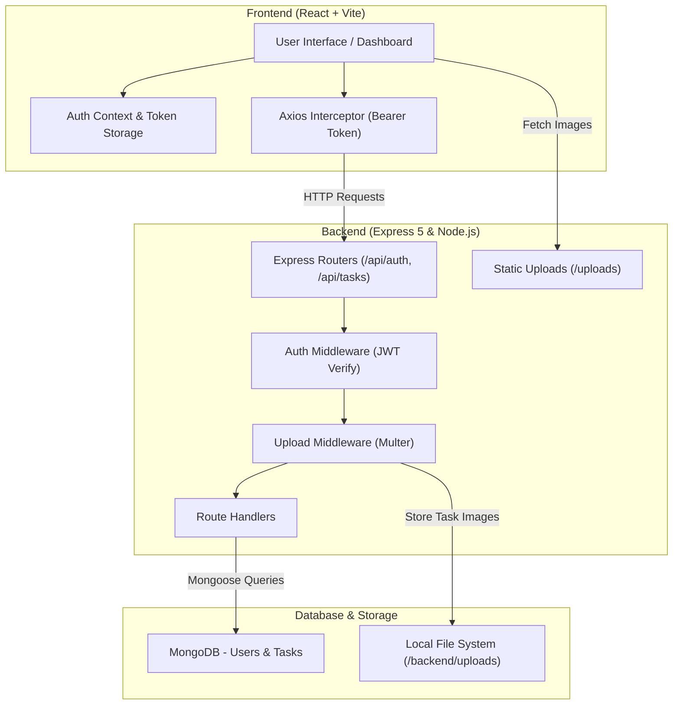

# 📝 Full-Stack To-Do & Task Management Application

A modern, full-stack Task Management application built with the **MERN** stack (MongoDB, Express, React, Node.js). It features JWT-based user authentication, protected routes, task management with image attachments via Multer, real-time client-side search and status filtering, and visual progress tracking.

---

## 📑 Table of Contents

- [📝 Full-Stack To-Do \& Task Management Application](#-full-stack-to-do--task-management-application)
  - [📑 Table of Contents](#-table-of-contents)
  - [✨ Features](#-features)
  - [🛠️ Tech Stack](#️-tech-stack)
    - [Frontend](#frontend)
    - [Backend](#backend)
  - [📐 Architecture \& Workflow](#-architecture--workflow)
  - [📂 Project Structure](#-project-structure)
  - [🚀 Getting Started](#-getting-started)
    - [Prerequisites](#prerequisites)
    - [1. Backend Setup](#1-backend-setup)
    - [2. Frontend Setup](#2-frontend-setup)
  - [🔑 Environment Variables](#-environment-variables)
  - [📡 API Documentation](#-api-documentation)
    - [Base URL](#base-url)
    - [Authentication Endpoints](#authentication-endpoints)
      - [1. Register User](#1-register-user)
      - [2. Login User](#2-login-user)
    - [Task Endpoints (Protected)](#task-endpoints-protected)
      - [1. Get All Tasks](#1-get-all-tasks)
      - [2. Create Task](#2-create-task)
      - [3. Update Task](#3-update-task)
      - [4. Delete Task](#4-delete-task)
  - [📜 Available Scripts](#-available-scripts)
    - [In `/backend`](#in-backend)
    - [In `/frontend`](#in-frontend)
  - [📄 License](#-license)

---

## ✨ Features

- **🔐 User Authentication & Authorization**:
  - Secure registration and login using **JWT (JSON Web Tokens)**.
  - Password hashing with **bcryptjs** before storing in MongoDB.
  - Client-side auth persistence in `localStorage` with `AuthContext`.
  - Protected client routes (`ProtectedRoute`) and server-side authentication middleware.

- **📋 Task Management (CRUD)**:
  - Create new tasks with title, description, and optional image attachments.
  - Mark tasks as completed or pending with one-click toggles.
  - Delete tasks securely with per-user ownership verification.
  - Reverse chronological sorting (newest tasks first).

- **🖼️ File & Image Uploads**:
  - Multipart form upload powered by **Multer**.
  - Server-side file validation (supports `jpeg`, `jpg`, `png`, `webp`, `gif`) and a 5 MB file size limit.
  - Static file serving from `/uploads` directory.

- **🔍 Search & Filtering**:
  - Instant client-side search across task titles and descriptions.
  - Status filter pills: **All**, **Pending**, and **Done**.

- **📊 Progress Tracking & Dashboard**:
  - Dynamic completion rate calculation and visual progress bar.
  - Counters displaying total, completed, and pending tasks.

---

## 🛠️ Tech Stack

### Frontend
- **Framework**: [React 19](https://react.dev/)
- **Bundler & Tooling**: [Vite 8](https://vitejs.dev/), [Oxlint](https://oxc.rs/)
- **Routing**: [React Router v7](https://reactrouter.com/)
- **HTTP Client**: [Axios](https://axios-http.com/) (with request interceptor for Bearer token authorization)
- **Styling**: Modern CSS with custom theme variables and glassmorphism styling

### Backend
- **Runtime**: [Node.js](https://nodejs.org/)
- **Framework**: [Express 5](https://expressjs.com/)
- **Database**: [MongoDB](https://www.mongodb.com/) with [Mongoose 9 ODM](https://mongoosejs.com/)
- **Authentication**: [jsonwebtoken (JWT)](https://jwt.io/), [bcryptjs](https://github.com/dcodeIO/bcrypt.js)
- **File Uploads**: [Multer](https://github.com/expressjs/multer)
- **Utilities**: `dotenv`, `cors`, `nodemon`

---

## 📐 Architecture & Workflow



---

## 📂 Project Structure

```text
todo-api/
├── backend/
│   ├── middleware/
│   │   ├── auth.js          # JWT verification & route protection middleware
│   │   └── upload.js        # Multer disk storage & image validation configuration
│   ├── models/
│   │   ├── Task.js          # Task Mongoose schema (user reference, image path, status)
│   │   └── User.js          # User Mongoose schema with pre-save bcrypt hook
│   ├── routes/
│   │   ├── authRoutes.js    # Register & Login route handlers
│   │   └── taskRoutes.js    # Protected CRUD routes for user tasks
│   ├── uploads/             # Server-side storage for uploaded task images
│   ├── .env.example         # Template for backend environment variables
│   ├── package.json         # Backend dependencies and scripts
│   └── server.js            # Express application entry point & MongoDB connection
│
├── frontend/
│   ├── public/              # Static assets and icons
│   ├── src/
│   │   ├── api/
│   │   │   └── axios.js     # Axios instance configured with base URL & auth header
│   │   ├── components/
│   │   │   ├── ProtectedRoute.jsx  # Route guard redirecting unauthenticated users
│   │   │   ├── TaskForm.jsx        # Task creation component with image preview
│   │   │   └── TaskItem.jsx        # Task display card with toggle & delete actions
│   │   ├── context/
│   │   │   └── AuthContext.jsx     # Global authentication provider and hook
│   │   ├── pages/
│   │   │   ├── Dashboard.jsx       # Main task dashboard with search, filter, progress
│   │   │   ├── Login.jsx           # User sign-in page
│   │   │   └── Register.jsx        # User registration page
│   │   ├── App.jsx          # Route configuration
│   │   ├── index.css        # Global CSS variables and styles
│   │   └── main.jsx         # React application root mount
│   ├── package.json         # Frontend dependencies and scripts
│   └── vite.config.js       # Vite configuration
│
└── README.md                # Project documentation
```

---

## 🚀 Getting Started

### Prerequisites

Ensure you have the following installed on your machine:
- **Node.js** (v18 or higher recommended)
- **npm** (or yarn / pnpm)
- **MongoDB** (running locally or a [MongoDB Atlas](https://www.mongodb.com/atlas) connection URI)

---

### 1. Backend Setup

1. Open a terminal and navigate to the `backend` directory:
   ```bash
   cd backend
   ```

2. Install dependencies:
   ```bash
   npm install
   ```

3. Configure environment variables:
   Create a `.env` file inside `backend/` by copying the example file:
   ```bash
   cp .env.example .env
   ```
   Update the `.env` values to match your local setup:
   ```env
   PORT=5000
   MONGO_URI=mongodb://localhost:27017/todo-api
   JWT_SECRET=your_secret_jwt_key
   ```

4. Start the backend development server:
   ```bash
   npm run dev
   ```
   > The server will start on `http://localhost:5000` and automatically connect to MongoDB.

---

### 2. Frontend Setup

1. Open a second terminal and navigate to the `frontend` directory:
   ```bash
   cd frontend
   ```

2. Install dependencies:
   ```bash
   npm install
   ```

3. Start the Vite development server:
   ```bash
   npm run dev
   ```

4. Open your browser and navigate to:
   ```
   http://localhost:5173
   ```

---

## 🔑 Environment Variables

The backend relies on the following environment variables defined in `backend/.env`:

| Variable | Description | Example / Default |
| :--- | :--- | :--- |
| `PORT` | Port number on which the Express server listens | `5000` |
| `MONGO_URI` | MongoDB connection string (Local or MongoDB Atlas) | `mongodb://localhost:27017/todo-api` |
| `JWT_SECRET` | Secret key used to sign and verify JSON Web Tokens | `your_super_secret_jwt_key` |

---

## 📡 API Documentation

### Base URL
```
http://localhost:5000/api
```

---

### Authentication Endpoints

#### 1. Register User
- **Endpoint**: `POST /api/auth/register`
- **Headers**: `Content-Type: application/json`
- **Request Body**:
  ```json
  {
    "name": "Alex Doe",
    "email": "alex@example.com",
    "password": "securepassword123"
  }
  ```
- **Success Response (201 Created)**:
  ```json
  {
    "_id": "6640abcd...",
    "name": "Sonu Sood",
    "email": "Sonu@example.com",
    "token": "eyJhbGciOiJIUzI1NiIsInR5cCI6IkpXVCJ9..."
  }
  ```

#### 2. Login User
- **Endpoint**: `POST /api/auth/login`
- **Headers**: `Content-Type: application/json`
- **Request Body**:
  ```json
  {
    "email": "Sonu@example.com",
    "password": "securepassword123"
  }
  ```
- **Success Response (200 OK)**:
  ```json
  {
    "_id": "6640abcd...",
    "name": "Sonu Sood",
    "email": "Sonu@example.com",
    "token": "eyJhbGciOiJIUzI1NiIsInR5cCI6IkpXVCJ9..."
  }
  ```

---

### Task Endpoints (Protected)

> All task endpoints require the `Authorization` header with a valid Bearer token:  
> `Authorization: Bearer <your_jwt_token>`

#### 1. Get All Tasks
- **Endpoint**: `GET /api/tasks`
- **Response**: List of tasks belonging to the authenticated user, sorted with newest first.
  ```json
  [
    {
      "_id": "6641efgh...",
      "user": "6640abcd...",
      "title": "Design landing page wireframe",
      "description": "Prepare Figma components and export assets",
      "completed": false,
      "image": "/uploads/1715500000000-123456789.png",
      "createdAt": "2026-11-13T12:00:00.000Z",
      "updatedAt": "2026-11-13T12:00:00.000Z"
    }
  ]
  ```

#### 2. Create Task
- **Endpoint**: `POST /api/tasks`
- **Headers**: `Content-Type: multipart/form-data`
- **Form Data Fields**:
  - `title` *(string, required)*
  - `description` *(string, optional)*
  - `image` *(file, optional — jpg, jpeg, png, webp, gif up to 5MB)*
- **Success Response (201 Created)**: Returns the newly created task object.

#### 3. Update Task
- **Endpoint**: `PUT /api/tasks/:id`
- **Headers**: `Content-Type: application/json` or `multipart/form-data`
- **Body / Form Fields**:
  - `completed` *(boolean, optional)*
  - `title` *(string, optional)*
  - `description` *(string, optional)*
  - `image` *(file, optional)*
- **Success Response (200 OK)**: Returns the updated task object.

#### 4. Delete Task
- **Endpoint**: `DELETE /api/tasks/:id`
- **Success Response (200 OK)**:
  ```json
  {
    "message": "Task deleted successfully"
  }
  ```

---

## 📜 Available Scripts

### In `/backend`
- `npm run dev`: Starts the server with `nodemon` for automatic reloading on code changes.
- `npm start`: Runs the server directly using `node server.js`.

### In `/frontend`
- `npm run dev`: Starts the Vite development server with Hot Module Replacement (HMR).
- `npm run build`: Bundles the React application for production into `dist/`.
- `npm run preview`: Locally previews the production build.
- `npm run lint`: Runs `oxlint` to analyze code quality and potential issues.

---

## 📄 License

This project is licensed under the [ISC License](https://opensource.org/licenses/ISC).
